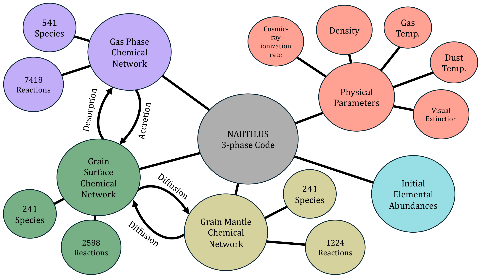
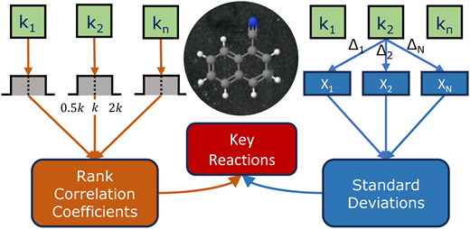

# Projects

{:.lead}

As a computational chemist, I have five years of experience developing novel computational tools and applying them to large-scale scientific problems. I love finding new ways to gain insight from complicated datasets and sharing those insights with others. Below you can read about individual projects of mine where I have develped skills spanning kinetic modeling, data science, and machine learning!

{:.lead}

1. this list will be replaced by the toc
{:toc .large-only}

## Computational Modeling of Hydrocarbon Chemistry

Throughout my graduate research, I have extensively developed kinetic models to simulate the chemistry of extreme, interstellar environments. These codes take in a large number of input parameters, set up a system of ordinary differential equations, and solve these equations for time-dependent molecular abundances. I have thoroghly revised this model using comprehensive literature reviews and data quality assessment. Building an accurate model is a detail-oriented process that requires understanding where the current data comes from, evaluating alternative sources of data to determine if they are more suitable, incorporating new parameters in a physically reasonable way, and keeping track of any assumptions made during this process. I have also written data analysis and visualization scripts with Python to rigorously analyze and benchmark the results of these models. 

One of the largest updates to this model was a research project that I led to incorporate new formation routes to large hydrocarbon molecules and revise existing reactions. I added and revised over 100 parameters including rate coefficients, product distributions, binding energies, and activation energies to create a model with some of the most in-depth carbon chemistry to-date.

{:.lead width="1920" height="1080" loading="lazy"}

The kinetic model I developed for investigating hydrocarbon chemistry includes thousands of physical and chemical input parameters.
{:.figcaption}

## BATMAN Chemical Model

Much of my work has been part of a large research collaboration where computational modeling work is being done across multiple institutions and countries. Consistent data management efforts are needed to track model development progress across institutions. I have led these data management efforts using a public GitHub repository and Git workflows. Using these tools, any member of the collaboration can easily fork the upstream repository, commit their own changes, and then submit a pull request for review to incorporate these changes upstream. Through this commit and pull request workflow, I can easily create transparent documentation regaring what changes were made, when they were made, and why they were made. This is especially ideal for the models I worked with where there are many input parameters. This GitHub repository contains a separate branch for each individual research project as well as a branch for general active development that concatenates changes from other branches. I have used Git and GitHub to document thousands of model changes across seven branches. The GitHub repository can be found [here](https://github.com/cixue/BATMAN), and my fork can be found [here](https://github.com/lxbyrne/BATMAN). 

## Sensitivity Analysis of Gas-Phase Chemistry

In any kind of computational model, there is uncertainty in the input parameters. Understanding how this uncertainty influences model results is essential for interpreting model results and improving accuracy. The kinetic models of interstellar chemistry that I work with contain thousands of parameters whose uncertainties are not well-quantified, primarily rate coefficients that control gas-phase chemistry. I developed two complementary sensitivity analysis techniques to analyze more than 7000 rate coefficients and identify ``key'' reactions that strongly influence model results. One of these is a local, one-at-a-time analysis that provides quantitative information about how the model responds to changes in individual parameters. Typical one-at-a-time analyses only apply a single, small perturbation to each parameter, making them difficult to difficult to extrapolate outside of these small ranges. To circumvent this weakness, I used a range of twenty perturbations for each rate coefficient. I also used a global, Monte Carlo approach that runs a large number of model iterations where in each iteration, all rate coefficients are randomly selected from pre-defined distributions. I then determined sensitivities using statistical correlations. 

I implemented these analyses using Python and bash programming along with parallel computing so that I could feasibly run over 150,000 model iterations. I then used Python programming with Numpy, Dask, and Pandas to analyze the large datasets that I generated, Matplotlib to create data visualization scripts, and HDF5 file formats to efficiently store large amounts of data in a hierarchical format. These results provide the astrochemistry community with actionable insight in the form of specific reactions that are high priorities for future study. I have made the data from this project, which includes the raw data, the worked-up sensitivities, and scripts for generating analyzing, and visualizing data, available to the public in a [Zenodo repository](https://zenodo.org/records/13257329).

{:.lead width="1440" height="1080" loading="lazy"}

I applied two sensitivity analysis techniques, one quantitative and one statistical, to identify key reactions in a chemical model.
{:.figcaption}

## Machine Learning for Model Visualization

Machine learning is a powerful tool for many scientific problems thanks to its abilities to learn complex patterns, perform high-throughput analysis, and even generate novel data. Early in my graduate career, I helped develop a machine learning pipeline to predict molecular abundances based on chemical structure. This pipeline uses a pre-trained autoencoder that converts string representations of molecular structures (ie. SMILES strings) into multi-dimensional vectors. I trained linear regression models on collected experimental data to predict molecular abundances based on these vectors. 

Later in my research career, I expanded this pipeline to create a new way of visualizing model behavior. Typically this data is visualized by plotting the time-series data of select molecules. I wanted to be able to have a holistic view of how the entire model evolves as a function of time. I used web-scraping tools to collect SMILES strings for all molecules in the model, transformed them into 32-dimensional vectors using the aforementioned pipeline, applied Uniform Manifold Approximation and Projection (UMAP) to reduce these vectors into two-dimensions, and plotted every molecule according to these dimensions. This allowed me to visualize the model in a machine-learned "chemical space", or a vector space where distance is a measure of chemical similarity. I used this method to create videos like the one below, where all of the point sizes are scaled by the fraction of carbon contained in that molecule at that time. Through these videos I am able to show how the main forms of carbon change as a function of time or any other desired parameter.  

<video width="844" height="790" controls loop="" muted="">
    <source src="https://github.com/lxbyrne/lxbyrne.github.io/raw/refs/heads/main/assets/img/Research/C_O_1.0.mp4" />
</video>

An output video of chemistry over time as visualized through the machine learning pipeline I developed. Each point is a molecule, the size is scaled by abundance of carbon, and the structures of molecules that contain at least 2% of carbon are shown.
{:.figcaption}
