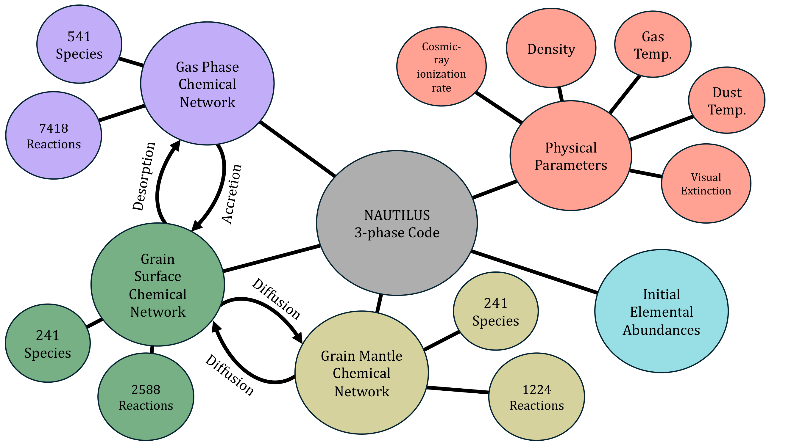

# Research

{:.lead}

I am a computational chemist with a research backround in astrochemistry, a highly interdisciplinary field that lies at the intersection of chemistry, astronomy, and astrophysics. I use chemical physics simulations, data science, and machine learning to investigate how chemistry happens under extreme conditions such as the low-temperature interstellar medium.

{:.lead}

## Modeling Carbon Chemistry in Cold Clouds

Molecular clouds are one of the earliest stages of the star formation process, where all of the material that will eventually become a solar system exists as a cloud of gas and dust. Radio astronomical observations have shown that a rich degree of chemistry happens at this stage, even with temperatures only a few degrees above absolute zero. Some of these detected molecules are known as, carbon-containing molecules with six or more atoms. I use kinetic models that simulate the chemical evolution of molecular clouds to understand the formation mechanisms behind detected complex organic molecules.

I am espeically interested in a class of molecule called polycyclic aromatic hydrocarbons (PAHs). On Earth, PAHs are pollutants that are created through incomplete combustion and lead to cancer, respiratory disease, and global warming. In space, they are thought to be widespread and major reservoirs of carbon. Individual PAHs have only been recently detected in the cold Taurus Molecular Cloud, an environment much unlike their terrestrial combustion origins. Much of my modeling work has focused on this new frontier of low-temperature PAH formation as part of the interdisciplinary and international GOTHAM collaboration, where I have found that hydrocarbons with three carbon atoms are critical precurors to PAHs whose interstellar chemistry is still not well-understood.

1. this list will be replaced by the toc
{:toc .large-only}

{:.lead width="1920" height="1080" loading="lazy"}

An overview of the kinetic model used in this project.
{:.figcaption}

## Sensitivity Analyses of Astrochemical Models

As the statistician George Box famously said, "All models are wrong, but some are useful". Building an astrochemical model requires many assumptions and uncertainties, but we still rely on them to expand our knowledge of interstellar chemistry. For example, rate coefficients are largely responsible for determining how the chemistry evolves over time, but these values are often estimated or extrapolated. Measuring or even calculating these rates under interstellar conditions is often a long, difficult, and resource-intensive process.

Part of my research uses sensitivity analyses as a powerful tool for determining how model uncertainty influences results and for identifying the most influential sources of uncertainty. These types of analyses are often used in many other areas of modeling, such as models of combustion chemistry and atmospheric chemistry. Even though uncertainties themselves are often not well quantified, sensitivity analyses provide a starting point for areas of further investigation by the astrochemistry community. Key reactions show that a reaction itself might benefit from more rigorous study, and also that alternative pathways may be worth exploring. Sensitivity analyses can also reveal unexpected behavior, such as strong, nonlinear relationships between reaction rates and abundances.

## C/O Ratio Across the Star Formation Cycle

The amount of total carbon relative to oxygen, or C/O ratio, has been known for decades to have a strong influence on the chemistry of molecular clouds. When the C/O ratio is below 1, oxygen chemistry dominates and most of the carbon is locked up as CO. When this ratio is above 1, carbon chemistry dominates and a variety of carbon-containing molecules can be formed. I have used kinetic modeling, sensitivity analyses, and machine learning to investigate how the chemistry in a large, molecular cloud model changes as a function of C/O ratio. Many of the hydrocarbons that have been detected in the Taurus Molecular Cloud cannot efficiently form at C/O ratios below 1, suggesting a carbon-rich environment for this cloud. However, even large C/O ratios alone cannot reproduce the abundances of PAHs.

In addition to influencing the chemistry of molecular clouds, the C/O ratio controls chemistry and physics across much of the star formation cycle. In protoplanetary disks, the C/O ratio is spatially dependent and determines the composition of the resulting planetary bodies. Recent observations of complex hydrocarbons in disks are consistent with unexpectedly large C/O ratios. It is possible that these large C/O ratios could be inherited from the previous molecular clouds, although there are still many questions surrounding how a molecular cloud collapses into a protoplanetary disk.

## Machine Learning

I am always interested in learning new computational tools and exploring how they can be applied to large-scale scientific questions. In fields like astrochemistry where experimental data and resources are limited, machine learning is an exciting avenue for exploration. I have used machine learning as a tool for predicting molecular candidates for interstellar detection as well as for visualizing model results as a function of time and C/O ratio. I am also interested in using machine learning for more efficient computational models, uncertainty analysis, and automated reaction discovery.